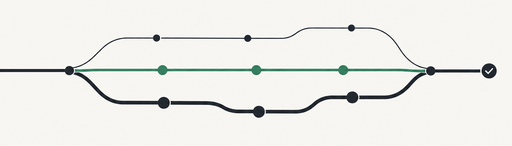

<div align="center">



<h1>HappyCoding Everyday</h1>

<p><strong>뛰어난 엔지니어의 습관을 당신의 AI 코딩 도우미에.</strong></p>

<p>작은 변경은 빠르게, 큰 변경은 꼼꼼하게. Codex나 Claude Code에 한 번만 설치하면 모든 코딩 작업이 더 믿음직해집니다. 설정은 필요 없습니다.</p>

[](https://github.com/caredhieacid/jensenmo-happy_coding_everyday/releases)
[](https://github.com/caredhieacid/jensenmo-happy_coding_everyday/actions/workflows/validate.yml)
[](#프로젝트-상태)
[](.claude-plugin/plugin.json)
[](LICENSE)

[English](README.md) · [简体中文](README.zh-CN.md) · [日本語](README.ja.md) · [한국어](README.ko.md) · [Español](README.es.md)

[왜 HappyCoding인가](#왜-happycoding인가) · [시작하기](#시작하기) · [해결하는 문제](#해결하는-문제) · [실제 예시](#실제-예시) · [테스트 결과](#테스트-결과) · [문서](docs/README.md)

</div>

## 왜 HappyCoding인가

- **설치하자마자 바로 동작.** 모드 선택도, 특별한 프롬프트도, 설정도 필요 없습니다. 평소처럼 요청하면 됩니다.
- **"끝났다"가 아니라 "제대로 고쳤다".** 진짜 원인을 찾고, 고쳐야 할 곳을 모두 고치고, 고쳐졌음을 보여 주는 검사를 실행합니다.
- **일을 부풀리지 않음.** 오타 수정은 한 줄 diff입니다. 계획서도, 불필요한 에이전트도, 요청하지 않은 기능도 없습니다.
- **사용자만 정할 수 있는 것만 질문.** 틀린 추측으로 다시 하게 만드는 대신, 분명한 선택지와 추천안을 붙인 짧은 질문을 합니다.
- **처음부터 안전.** API 키는 코드가 아니라 로컬 파일에 두고, 동의 없이 푸시하거나 배포하지 않으며, 프로젝트 규칙을 언제나 먼저 따릅니다.
- **자리를 거의 차지하지 않음.** 매번 불러오는 부분은 한 페이지 정도이고, 나머지는 필요한 작업에서만 읽습니다.
- **효과를 직접 측정함.** 깨끗한 Codex 세션에서 같은 작업 18개를 두 번씩 실행했더니, 모든 항목을 충족한 횟수가 HappyCoding 없이는 36회 중 18회, 있을 때는 29회였습니다.

## 시작하기

**Codex:** 터미널에서 명령 두 개를 실행합니다.

```bash
codex plugin marketplace add caredhieacid/jensenmo-happy_coding_everyday
codex plugin add jensenmo-happy-coding-everyday@jensenmo-happy-coding
```

**Claude Code:** 터미널에서 명령 두 개를 실행합니다.

```bash
claude plugin marketplace add caredhieacid/jensenmo-happy_coding_everyday
claude plugin install jensenmo-happy-coding-everyday@jensenmo-happy-coding
```

두 경우 모두 첫 번째 명령은 이 GitHub 저장소를 플러그인 출처로 추가하고, 두 번째 명령은 플러그인을 설치합니다. HappyCoding은 아직 공식 플러그인 목록에 올라가 있지 않아서 가입이나 심사가 필요 없습니다. Claude Code 세션 안에서는 `/plugin marketplace add`와 `/plugin install`로도 할 수 있고, Codex에서는 첫 번째 명령 뒤에 **Plugins** 화면에서 설치해도 됩니다.

git과 최신 버전의 Codex 또는 Claude Code가 필요합니다. `plugin` 명령을 찾을 수 없다고 나오면 먼저 도구를 업데이트하세요. 두 도구 모두 최신 정식 릴리스를 설치하며, 아직 릴리스되지 않은 변경은 받지 않습니다.

그다음 새 작업에서 평소처럼 요청하면 되고, 따로 설정할 것은 없습니다.

```text
로그인 버그를 고쳐 줘. 다른 변경은 그대로 두고, 무엇을 확인했는지 알려 줘.
```

이름으로 직접 부르려면 `$jensenmo-happy-coding-everyday`를 입력합니다.

## Skill 직접 설치

```bash
git clone https://github.com/caredhieacid/jensenmo-happy_coding_everyday.git
cd jensenmo-happy_coding_everyday
mkdir -p "$HOME/.agents/skills"
ln -s "$(pwd)/skills/jensenmo-happy-coding-everyday" \
  "$HOME/.agents/skills/jensenmo-happy-coding-everyday"
```

그 경로에 이미 무언가 있다면 바꾸기 전에 내용을 확인하세요.

**Claude Code:** 플러그인을 설치하는 대신 같은 폴더를 `~/.claude/skills/`에 링크해도 됩니다. 둘 다 쓰면 skill이 두 번 로드되니 하나만 쓰세요.

동작 테스트는 지금까지 Codex에서 했습니다. Claude Code에서는 `claude plugin validate` 검사와 실제 설치를 확인했습니다.

**Agent Skills를 지원하는 다른 도구:** 이 skill은 공개된 Agent Skills 형식을 쓰기 때문에 GitHub Copilot, Cursor, Gemini CLI, OpenCode 등 많은 도구가 읽을 수 있습니다. 이런 도구에서 쓰려면 `skills/jensenmo-happy-coding-everyday` 폴더를 각 도구의 skills 폴더에 복사하거나 링크하세요. 위치는 각 도구의 문서를 확인하세요. 지금까지 실제로 테스트한 것은 Codex와 Claude Code뿐입니다.

## 해결하는 문제

AI 코딩 도우미는 뛰어나지만, 완전히 맡겨 두면 흔히 두 가지 방식으로 실수합니다.

| 부족한 경우 | 지나친 경우 |
| --- | --- |
| 의심스러워 보이는 한 줄만 고치고, 진짜 원인은 찾지 않음 | 오타 하나 고치려고 계획을 쓰고 에이전트를 여러 개 띄움 |
| 같은 로직이 두 군데 있는데 한 곳만 고침 | 한 줄 바꾸는데도 전체 테스트를 돌리고 리뷰를 한 번 더 함 |
| 아무것도 실행하지 않고 "고쳤습니다"라고 함 | 아무도 요청하지 않은 검증, 설정, README를 덧붙임 |
| 요청 세 가지 중 하나를 슬그머니 빼먹음 | 그라데이션, 이모지, 광고 문구로 가득한 템플릿 같은 화면을 만듦 |
| API 키를 코드에 넣어 달라고 하면 그대로 넣음 | 일을 시작하기 전에 어떤 워크플로를 쓸지 고르라고 함 |

무거운 워크플로 도구들은 왼쪽 문제를 해결하지만, 대신 모든 작업이 오른쪽 절차를 거쳐야 합니다. HappyCoding은 둘 다 해결합니다. 작업의 크기와 위험도를 보고 얼마나 할지 정하므로, 꼼꼼한 결과를 불필요한 부담 없이 얻을 수 있습니다.

## 할 수 있는 일

| 기능 | 내용 |
| --- | --- |
| **작업에 맞는 진행** | 작은 작업은 바로 처리합니다. 보안, 데이터, 운영 환경과 관련된 변경에만 확인을 더합니다. 모드를 고를 필요가 없습니다. |
| **고친 뒤 실제로 확인** | 먼저 문제를 재현하고, 마지막 수정 후에 관련 검사를 실행하며, 확인하지 못한 부분은 분명히 알려 줍니다. |
| **어설프게 고치지 않음** | 호출하는 곳, 중복 코드, 설정, 문서처럼 영향을 받는 곳을 모두 찾아 함께 고치거나, 고치지 않는 이유를 알려 줍니다. |
| **꼭 필요할 때만 질문** | 추측이 틀리면 다시 해야 하는 일은 선택지 2~4개와 추천안을 붙인 짧은 질문으로 확인합니다. 코드를 보면 알 수 있는 건 묻지 않습니다. |
| **요청하지 않은 건 하지 않음** | 요청하지 않은 기능, 설정, 장식, 문서는 추가하지 않습니다. |
| **흔한 실수를 막음** | 보고하기 전에 변경 종류별 짧은 목록을 확인합니다. 경계값, 호환성, 데이터, 금액과 날짜, 화면의 로딩과 오류 상태 등입니다. |
| **처음부터 안전** | API 키는 코드나 커밋이 아니라 git이 추적하지 않는 로컬 파일에 둡니다. 요청하지 않으면 커밋, 푸시, 배포를 하지 않습니다. 프로젝트 자체 규칙을 먼저 따릅니다. |
| **묻지 않은 것도 알려 줌** | 보고 끝에 알아 두면 좋은 것을 최대 세 가지 덧붙입니다. 위험, 빠진 부분, 더 간단한 방법 같은 것입니다. |
| **깔끔한 화면** | 새 화면은 기존 컴포넌트와 스타일로 만듭니다. 아직 디자인이 없으면 맞는 것 중 가장 단순한 기술로 정돈된 페이지를 만들고, 장식이나 중복된 제목은 넣지 않습니다. |
| **한 번에 끝까지** | 변경에 필요한 부분(백엔드, 화면, 문서, 테스트)을 먼저 파악해 함께 끝냅니다. 하나씩 따로 요청할 필요가 없습니다. |
| **보안 리뷰** | 실제 결함을 해당 줄까지 짚고, 어떻게 악용될 수 있는지와 고치는 방법을 알려 줍니다. 문제없는 코드는 지적하지 않습니다. |
| **기술 스택을 강요하지 않음** | 프로젝트가 이미 쓰는 기술과 방식을 따릅니다. 작은 스크립트에 대형 서비스용 방식을 끌어오지 않습니다. |
| **알기 쉬운 보고** | 결과부터, 사용자의 언어로 알려 줍니다. 무엇을 바꿨는지, 무엇을 확인했는지, 무엇이 남았는지, 다음에 무엇을 하면 되는지. |

## 실제 예시

테스트에서 AI가 실제로 한 답변이며, 손대지 않았습니다. 테스트 환경이 중국어로 답하도록 설정되어 있어서 여기서는 한국어로 옮겼습니다.

**사용자만 정할 수 있는 건 먼저 묻습니다.** 요청: *"Change the date format on invoices."* (청구서의 날짜 형식을 바꿔 줘)

> 어떤 날짜 형식으로 바꿀까요? 현재 발행일과 납부 기한은 모두 `2026-10-22`로 표시됩니다.
>
> - `22/10/2026` (일/월/년)
> - `10/22/2026` (월/일/년)
> - `22 Oct 2026` (추천: 일과 월을 헷갈리지 않음)
>
> 정해 주시면 두 곳을 함께 고치고 테스트를 실행하겠습니다.

답을 받기 전까지 파일은 하나도 바꾸지 않았습니다.

**프로젝트 구조에 맞춰 작성합니다.** 요청: *"Add an endpoint that returns how many open tasks a project has."* (프로젝트의 미완료 작업 수를 돌려주는 API를 추가해 줘)

> `GET /projects/{id}/tasks/open-count`를 추가했고 `{"open_count": 2}`를 반환합니다.
>
> - 해당 프로젝트의 `open` 작업만 세며, 미완료 작업이 없으면 0을 반환합니다.
> - 정수가 아닌 ID는 400, 존재하지 않는 프로젝트는 404를 반환합니다.
> - 기존 3계층 구조를 그대로 따르고 API 문서도 업데이트했습니다.
>
> `python3 -m unittest discover -s tests`를 실행해 테스트 8개가 모두 통과했고 `git diff --check`도 문제없습니다. 변경은 로컬에만 있고 커밋하지 않았습니다.

**한 줄로 고칠 수 있으면 한 줄만 고칩니다.** 요청: *"A production button label has one typo. Change only that string…"* (운영 중인 버튼 문구에 오타가 하나 있어. 그 문자열만 고쳐 줘…)

> `CheckoutButton.jsx:5`의 `Sumbit order`를 `Submit order`로 고쳤습니다. 바뀐 것은 이 문자열 하나뿐입니다.
>
> diff를 확인했고 `git diff --check`도 문제없습니다. 전체 테스트는 실행하지 않았고, 커밋이나 배포도 하지 않았습니다.

## 테스트 결과

정말 도움이 되는지 확인하려고, 깨끗한 Codex 세션에서 같은 작업 18개를 HappyCoding이 있을 때와 없을 때 각각 두 번씩 실행했습니다. 모든 실행은 미리 써 둔 체크리스트에 따라 다른 리뷰어가 채점했습니다.

| | 없음 | HappyCoding 있음 |
| --- | --- | --- |
| 모든 항목을 충족한 횟수 | 36회 중 18회 | **36회 중 29회** |
| 평균 품질 점수 (1~5) | 3.4 | **4.2** |

차이가 가장 컸던 작업:

- **"이 주문 데이터를 목록으로 보여 주고 상태로 걸러 볼 수 있는 페이지를 만들어 줘."** 없음: 사이드바, 통계 카드, 검색, 정렬에 자체 서버까지 있는 관리 화면. 있음: 요청한 일만 하는 단순한 파일 세 개.
- **"우리 카페의 보기 좋은 홈페이지를 만들어 줘."** 없음: 문구를 지어내고, `npm run dev`를 실행해야 열리는 페이지. 있음: 주인이 준 글만 쓰고 더블클릭으로 열리는, 디자인된 페이지.
- **"코딩을 몰라요. 가계부 작은 도구를 만들어 주세요."** 없음: 요청하지 않은 차트, 분류, CSV 내보내기. 있음: 기록, 수정, 삭제, 월별 합계에 더해 데이터가 어디에 저장되고 어떻게 사본을 남기는지 알려 줌.
- **보안 리뷰.** 둘 다 심어 둔 결함을 찾았지만, 확인해서 문제없던 부분까지 알려 준 것은 HappyCoding이 있는 실행뿐이었습니다.

더 작고 저렴한 모델에서는 효과가 더 큽니다. `gpt-6-luna`에서는 작업 19개가 모든 항목을 충족한 횟수가 없을 때 38회 중 9회, 있을 때 20회였습니다. 스스로 테스트를 실행하기 시작한 것이 주된 이유입니다.

버그 원인 추적이나 커밋 규칙 따르기처럼 모델이 원래 잘하는 작업에서는 결과가 같았습니다.

테스트 시나리오는 30개, 예제 프로젝트는 19개입니다. 실패를 포함한 전체 기록은 [docs/pressure-tests.md](docs/pressure-tests.md)에 있습니다.

**스스로를 사용해 개발.** HappyCoding은 HappyCoding으로 개발합니다. 지금까지 병합한 PR은 16개이고, 모든 PR에서 CI를 실행합니다. 릴리스 패키지는 출처를 확인할 수 있고, 공개한 뒤에는 바꿀 수 없습니다.

HappyCoding 덕분에 시간을 아꼈다면 저장소에 스타를 눌러 주세요. 다른 개발자들이 이 프로젝트를 찾는 가장 쉬운 방법입니다.

## 세 가지 진행 방식

| 방식 | 쓰는 때 | 하는 일 |
| --- | --- | --- |
| **Everyday** | 한 사람이 맡을 수 있는 분명한 작업 | 코드를 읽고, 가장 작게 고치고, 결과를 보여 주는 검사를 실행 |
| **Collaboration** | 서로 관련 없는 부분으로 나눌 수 있거나, 읽을 코드가 많은 작업 | 여러 도우미가 동시에 조사하고, 공유 파일은 한 명만 수정 |
| **Delivery** | 보안, 데이터베이스 마이그레이션, 운영 환경, 여러 팀에 걸친 배포 | 계획을 쓰고, 단계마다 확인하고, 다른 사람의 리뷰를 받고, 되돌리는 방법을 준비 |

위험한 부분이 끝나면 Everyday로 돌아갑니다. PR을 올리거나, 파일을 많이 바꾸거나, 로컬에서 엔드투엔드 테스트를 한다는 이유만으로 Delivery가 되지는 않습니다. 매번 불러오는 것은 한 페이지 정도인 `SKILL.md`뿐이고, 나머지 파일은 필요할 때만 읽습니다.

## 설계 원칙

- **요청은 한 번만**: 진행 방식은 skill이 정합니다. 모드를 고를 필요가 없습니다.
- **가볍게 시작**: 분명한 이유가 있을 때만 절차를 더합니다.
- **확인은 결과를 증명해야 함**: "명령이 실행됐다"만으로는 부족합니다.
- **사용자만 정할 수 있는 것만 질문**: 나머지는 스스로 정하고 전제를 알려 줍니다.
- **요청한 것만 함**.
- **프로젝트 규칙이 먼저**.
- **읽기만 하라면 읽기만**: 리뷰나 조사 중에 코드를 바꾸지 않습니다.

자세한 내용은 [설계 원칙](docs/design-philosophy.md)과 [아키텍처](docs/architecture.md)를 참고하세요.

## 테스트와 릴리스

```bash
python3 -m unittest discover -s tests -p 'test_*.py'
python3 scripts/validate_repository.py
```

`.codex-plugin/plugin.json`의 버전과 같은 `v*` 태그를 붙이면, 플러그인 패키지와 SHA-256 체크섬이 들어간 GitHub Release가 자동으로 만들어집니다.

## 프로젝트 상태

지금은 **Alpha** 버전이며 바로 쓸 수 있습니다. 주요 기능, 플러그인 패키지, 자동 검사, 채점된 테스트 시나리오 전체가 갖춰져 있습니다. 앞으로의 릴리스에서도 실제 사용을 바탕으로 판단을 계속 다듬습니다. 어떤 도구든 마찬가지로, 운영 환경에 배포하기 전에는 변경 내용을 확인하세요.

## 라이선스

[MIT](LICENSE) © 2026 Jensen Mo
