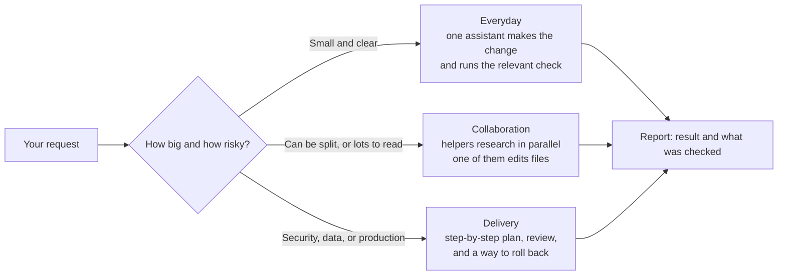

<div align="center">


<h1>HappyCoding Everyday</h1>

<p><strong>The habits of a great engineer, built into your AI coding assistant.</strong></p>

<p>Small changes stay quick. Big changes get done carefully. Install it once in Codex and every coding task gets better, with nothing to configure.</p>

[](https://github.com/caredhieacid/jensenmo-happy_coding_everyday/releases)
[](https://github.com/caredhieacid/jensenmo-happy_coding_everyday/actions/workflows/validate.yml)
[](#project-status)
[](.codex-plugin/plugin.json)
[](LICENSE)

[English](README.md) · [简体中文](README.zh-CN.md) · [日本語](README.ja.md) · [한국어](README.ko.md) · [Español](README.es.md)

[Why HappyCoding](#why-happycoding) · [Quick start](#quick-start) · [Examples](#examples) · [Test results](#test-results) · [How it works](#how-it-works) · [Docs](docs/README.md)

</div>

## Why HappyCoding

- **Works the moment it's installed.** No modes, no special prompts, no config. Describe the task the way you always do.
- **Gets it right, not just "done."** It finds the real cause, fixes every place that needs it, and runs the check that proves the fix.
- **Never bloats your work.** A typo fix is a one-line diff. No plans, extra agents, or features nobody asked for.
- **Asks only what only you can decide.** One short question with clear options and a recommendation, instead of a wrong guess you have to undo.
- **Safe by default.** API keys stay out of your code, nothing gets pushed or deployed without you, and your project's rules always come first.
- **Tiny footprint.** The part loaded on every task is under 60 lines, so your context stays free for your code.
- **Tested like real software.** Each key behavior has its own test scenario, run in fresh Codex sessions and scored by a separate reviewer.

## Quick start

Two commands in your terminal:

```bash
codex plugin marketplace add caredhieacid/jensenmo-happy_coding_everyday
codex plugin add jensenmo-happy-coding-everyday@jensenmo-happy-coding
```

The first adds this GitHub repository as a plugin source in Codex. HappyCoding isn't in an official
plugin directory yet, so no account or approval is involved. The second installs the plugin. You can
also run only the first command, then open **Plugins** in Codex, choose **JensenMo HappyCoding**, and
install **HappyCoding Everyday** there.

That's it. Start a new task and ask for things as you normally would:

```text
Fix the login bug, keep my other changes, and tell me what you checked.
```

```text
Review this API contract without changing anything. Point to where each field is produced and used.
```

```text
Add tenant isolation across the database, permissions, UI, and rollout. Keep a way to roll back.
```

To call it by name, type `$jensenmo-happy-coding-everyday`.

<details>
<summary><strong>Other ways to install</strong></summary>

**Link the skill folder directly** (handy if you want to edit it and see changes right away):

```bash
git clone https://github.com/caredhieacid/jensenmo-happy_coding_everyday.git
cd jensenmo-happy_coding_everyday
mkdir -p "$HOME/.agents/skills"
ln -s "$(pwd)/skills/jensenmo-happy-coding-everyday" \
  "$HOME/.agents/skills/jensenmo-happy-coding-everyday"
```

Codex supports linked skill folders. If something already exists at that path, check it before
replacing it. Older installs under `~/.codex/skills` may still work, but `$HOME/.agents/skills` is
the current location.

**Claude Code:** link the same folder into `~/.claude/skills/` and the skill loads there too. So
far, the behavior tests have only been run on Codex.

Keep just one skill that takes over all coding work: turn off other skills that do the same job,
and keep skills that only cover one area. See [Getting started](docs/getting-started.md).

</details>

## The problem it solves

AI coding assistants are capable, but left on their own they tend to go wrong in one of two ways.

| Not enough | Too much |
| --- | --- |
| Changes the first line that looks suspicious instead of finding the real cause | Writes a plan and starts several agents to fix a typo |
| The same logic exists in two places; only one gets fixed | Runs every test and another review round for a one-line change |
| Says "done" without running anything | Adds validation frameworks, settings, and README sections nobody asked for |
| One of three requirements quietly gets dropped | Builds pages full of gradients, emoji, and marketing copy that look like a template |
| You ask it to put an API key in the code, and it does | Asks you to pick a workflow mode before it starts |

Heavy workflow tools fix the left column, but then every task has to go through the right one.
HappyCoding fixes both: it decides how much process each task needs from its size and risk, so
you get careful work without the overhead.

## What you get

| Feature | What it means |
| --- | --- |
| **Process that fits the task** | Small tasks are done directly. Only changes that touch security, data, or production get extra checks. You never pick a mode. |
| **It actually checks its work** | It reproduces the problem first, runs the relevant check after the last edit, and tells you what it didn't check. |
| **Nothing half-fixed** | It looks for every other place the change affects (callers, duplicate code, config, docs) and updates them, or says why not. |
| **Asks only when it matters** | If a wrong guess would mean redoing work, it asks one short question with two to four options and a recommendation. If the code can answer it, it doesn't ask. |
| **No extras** | No features, settings, decoration, or docs you didn't ask for. |
| **Covers the usual cases** | Before reporting, it checks a short list for the kind of change it made: edge cases, compatibility, data, money and dates, and loading and error states in the UI. |
| **Safe by default** | API keys stay out of code and commits. Nothing is committed, pushed, or deployed unless you ask. Your project's own rules come first. |
| **UI that matches your app** | New pages reuse your existing components and styles instead of a generic template look. |
| **Clear reports** | The result comes first, in your language: what changed, what was checked, what's left, and what to do next. |

## Examples

These are real replies from test runs, unedited. The test machine is set to reply in Chinese, so
the replies below are translated.

**It asks when only you can decide.** Request: *"Change the date format on invoices."*

> Which date format would you like? Issued and due dates currently show as `2026-10-22`.
>
> - `22/10/2026` (day/month/year)
> - `10/22/2026` (month/day/year)
> - `22 Oct 2026` (recommended: avoids day/month confusion)
>
> Once you confirm, I'll update both places and run the tests.

It didn't change any file before getting an answer.

**It follows your project's structure.** Request: *"Add an endpoint that returns how many open tasks a project has."*

> Added `GET /projects/{id}/tasks/open-count`, returning `{"open_count": 2}`.
>
> - Counts only the project's `open` tasks; returns 0 when there are none.
> - A non-integer ID returns 400; an unknown project returns 404.
> - Kept the existing three layers and updated the endpoint docs.
>
> Ran `python3 -m unittest discover -s tests`: all 8 tests pass; `git diff --check` passes. The change is local only and not committed.

**A one-line fix stays one line.** Request: *"A production button label has one typo. Change only that string…"*

> Changed `Sumbit order` to `Submit order` in `CheckoutButton.jsx:5`; that string is the only change.
>
> Checked the diff and `git diff --check` passes. The full suite was not run, and nothing was committed or deployed.

<details>
<summary><strong>It explains results in plain words</strong></summary>

Request (originally in Chinese): *"I just started learning to code. My budget program's total looks
wrong, like a lot of money is missing. Can you fix it? I don't really know Git, so don't break
my stuff."*

> Fixed. The program was skipping the first entry, **1,200 of rent**, so the total now shows
> correctly as **1383.00**.
>
> Only one line in `budget.py` changed. Your ledger data is untouched, and no branch was switched
> and nothing was committed. Checked with the full ledger, a single entry, and an empty ledger;
> all correct.
>
> Run it the same way as before:
>
> ```bash
> python3 budget.py expenses.csv
> ```

</details>

## Test results

Many prompt and workflow collections are never tested. HappyCoding is. Each key behavior has a
test scenario: a realistic request, a small sample project, a list of things the assistant must do, and a list of
things it must never do. Every test starts a new Codex session, and a separate reviewer checks the
result against both lists.

| Item | Count |
| --- | --- |
| Test scenarios | **24** |
| Sample projects (frontend, layered backend, money math, API keys, commit rules, and more) | **12** |
| New Codex sessions run for version 0.3.0 | **59** |
| Sessions scored line by line by a separate reviewer | **48** |

**Passed in every scored round:**

- found the real cause instead of stopping at misleading code;
- kept a one-line fix to one line;
- followed the project's documented branch and commit rules;
- kept a pasted API key out of files that get committed;
- put backend code in the layers the project docs describe;
- built new pages only from the existing styles.

The full test record is in [docs/pressure-tests.md](docs/pressure-tests.md).

**Built with itself.** HappyCoding is developed using HappyCoding. So far: 9 merged pull requests,
CI on every pull request, and release packages that can be verified and can't be changed after
publishing.

If HappyCoding saves you time, please star the repo. It's the easiest way to help other
developers find it.

## How it works



| Mode | When | What it does | Example |
| --- | --- | --- | --- |
| **Everyday** | One clear task that one person can own | Reads the code, makes the smallest change, runs the check that proves it | Fix a parser bug and open a normal PR |
| **Collaboration** | The work splits into unrelated parts, or there is a lot of code to read | Several helpers investigate at once; only one edits shared files | Look into an unrelated login 401 and a CSV column-order bug at the same time |
| **Delivery** | Security, database migrations, production, or a rollout across teams | Writes down the plan, checks each step, gets an independent review, prepares a rollback | Add tenant isolation across the database, permissions, UI, and rollout |

Once the risky part is done, it goes back to Everyday. Opening a pull request, touching many
files, or running an end-to-end test locally does not, by itself, make a task Delivery.

**Light on context.** Only `SKILL.md` (under 60 lines) is loaded for every task. The other files
are read only when needed:

| File | When it's read |
| --- | --- |
| [`SKILL.md`](skills/jensenmo-happy-coding-everyday/SKILL.md) | Every coding task |
| [`engineering-baseline.md`](skills/jensenmo-happy-coding-everyday/references/engineering-baseline.md) | The change involves Git, API keys, security, data, APIs, backend modules, dependencies, setup, UI, LLM calls, or tests |
| [`change-checklist.md`](skills/jensenmo-happy-coding-everyday/references/change-checklist.md) | Before reporting, after changing logic, data, an API, or UI, or fixing a bug |
| [`lanes.md`](skills/jensenmo-happy-coding-everyday/references/lanes.md) | It isn't clear which mode to use |
| [`contracts-and-evidence.md`](skills/jensenmo-happy-coding-everyday/references/contracts-and-evidence.md) | Work is handed to another assistant |

## Design principles

1. **Say it once.** It works out the process; you never pick a mode.
2. **Start light.** Add process only when there is a concrete reason.
3. **A check has to prove the result.** "The command ran" is not enough.
4. **Many can read, one edits.** Shared files have a single editor.
5. **Check again after the last edit.** An earlier passing run doesn't count.
6. **Ask only what only you can decide.** Decide the rest and say what was assumed.
7. **Do only what was asked.**
8. **Your project's rules come first.**
9. **Read-only means read-only.** A review or investigation doesn't change code.
10. **Looking things up is always fine.** Searching, reading docs, or opening a browser needs no extra process; process is for changes and risk.

More in [Design philosophy](docs/design-philosophy.md) and [Architecture](docs/architecture.md).

## Compared with similar projects

HappyCoding is written from scratch. It learns from these projects but doesn't copy their
instructions or need them installed.

| Project | Good at | What HappyCoding does |
| --- | --- | --- |
| [Superpowers](https://github.com/obra/superpowers) | Systematic debugging, re-checking after changes, behavior tests | Just as strict, but only as much as each task needs, instead of the full process every time |
| [GitHub Spec Kit](https://github.com/github/spec-kit) | Spec documents and plans built around what you want | Writes plans only for big, long-running work, not for everyday edits |
| [Anthropic Skills](https://github.com/anthropics/skills) | Well-structured, self-contained skills | Keeps the always-loaded part short and puts human docs outside it |
| [OpenAI Plugins](https://github.com/openai/plugins) | Codex plugin packaging and the plugin marketplace | One skill, packaged as an installable plugin |
| [Awesome Copilot](https://github.com/github/awesome-copilot) | Clear categories and easy community entry | Test scenarios a script can read, issue templates, and easy-to-follow docs |

## What it won't do

- It isn't a new AI framework or runtime.
- It doesn't force multiple agents, plan documents, TDD, or running every test.
- It doesn't replace your team's engineering rules; it follows them.
- Being able to run on its own doesn't mean it will deploy, delete data, migrate a database, or force-push.
- It doesn't measure success by the number of agents, documents, or tool calls.

## Testing and releases

- **Automated checks:** skill format, plugin packaging, doc links, translations, and test scenario format.
- **Behavior tests:** realistic requests in new sessions, scored against a checklist.
- **Real use:** the only real proof that a change works in your project.

```bash
python3 -m unittest discover -s tests -p 'test_*.py'
python3 scripts/validate_repository.py
python3 scripts/run_scenarios.py [scenario-id ...]
```

Every pull request builds a preview of the plugin package. Pushing a `v*` tag that matches the
version in `.codex-plugin/plugin.json` creates a GitHub Release with the package and its SHA-256
checksum. Releases are built from `main`, the package can be verified, and a release can't be
changed after publishing. See [how the tests work](docs/evaluation-methodology.md).

## Repository layout

```text
.
├── .codex-plugin/                  # Codex plugin manifest
├── .agents/plugins/                # Plugin marketplace entry
├── .github/                        # CI, release automation, issue templates
├── docs/                           # Design notes, test records, images
├── scripts/                        # Checks, packaging, test runner
├── skills/
│   └── jensenmo-happy-coding-everyday/
│       ├── SKILL.md                # The part loaded for every task
│       ├── agents/openai.yaml      # Codex settings for the skill
│       └── references/             # Read only when needed
└── tests/                          # Checks, test scenarios, sample projects
```

## Documentation

- [Documentation index](docs/README.md)
- [Getting started](docs/getting-started.md)
- [Architecture](docs/architecture.md)
- [Design philosophy](docs/design-philosophy.md)
- [How the behavior tests work](docs/evaluation-methodology.md)
- [Test record](docs/pressure-tests.md)
- [Roadmap](docs/roadmap.md)
- [Translation guide](docs/i18n/translation-guide.md)

## Project status

HappyCoding Everyday is in **Alpha** and ready to use: the core features, the plugin package, the
automated checks, and a full set of scored test scenarios are in place. New releases keep tuning
its judgment based on real use. As with any tool, review what it does before deploying to
production. See [CHANGELOG.md](CHANGELOG.md) and [the roadmap](docs/roadmap.md).

## Contributing

- Suggest a real test scenario or a behavior change: see [Contributing](CONTRIBUTING.md).
- Report a security issue: see [Security](SECURITY.md).
- Get help: see [Support](SUPPORT.md).
- Please follow the [Code of Conduct](CODE_OF_CONDUCT.md).

## License

[MIT](LICENSE) © 2026 Jensen Mo
