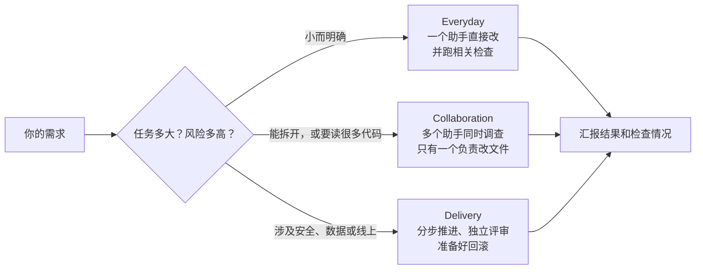

<div align="center">


<h1>HappyCoding Everyday</h1>

<p><strong>把优秀工程师的好习惯，装进你的 AI 编程助手。</strong></p>

<p>小改动不折腾，大改动不马虎。在 Codex 或 Claude Code 里装一次，之后每个编码任务都会变得更靠谱，不需要任何配置。</p>

[](https://github.com/caredhieacid/jensenmo-happy_coding_everyday/releases)
[](https://github.com/caredhieacid/jensenmo-happy_coding_everyday/actions/workflows/validate.yml)
[](#项目状态)
[](.codex-plugin/plugin.json)
[](.claude-plugin/plugin.json)
[](LICENSE)

[English](README.md) · [简体中文](README.zh-CN.md) · [日本語](README.ja.md) · [한국어](README.ko.md) · [Español](README.es.md)

[为什么选它](#为什么选它) · [快速开始](#快速开始) · [实际效果](#实际效果) · [测试结果](#测试结果) · [工作方式](#工作方式) · [文档](docs/README.md)

</div>

## 为什么选它

- **装上就能用。** 不用选模式，不用学特殊提示词，也不用配置。平时怎么提需求，现在还怎么提。
- **不只是"改完了"，而是改对了。** 它会找到真正的原因，把该改的地方都改到，再跑能证明修好了的检查。
- **从不把事情搞复杂。** 改一个错别字就是一行改动，不写计划、不开一堆 agent，也不加没人要的功能。
- **只问你才能决定的事。** 给你一个简短问题、几个清楚的选项和一个推荐，而不是猜错了让你返工。
- **默认就安全。** API 密钥不进代码，没有你同意不推送、不部署，项目自己的规范永远优先。
- **几乎不占上下文。** 每次都加载的部分不到 60 行。按 Claude Code 自己的估算，每个会话只占约 90 个 token，真正用到时才约 1.7k。
- **像正经软件一样经过测试。** 每个关键行为都有自己的测试场景，在全新的 Codex 会话里运行，由另一个评审打分。

## 快速开始

**Codex：** 在终端里运行两条命令。

```bash
codex plugin marketplace add caredhieacid/jensenmo-happy_coding_everyday
codex plugin add jensenmo-happy-coding-everyday@jensenmo-happy-coding
```

**Claude Code：** 在终端里运行两条命令。

```bash
claude plugin marketplace add caredhieacid/jensenmo-happy_coding_everyday
claude plugin install jensenmo-happy-coding-everyday@jensenmo-happy-coding
```

每组的第一条命令把这个 GitHub 仓库添加为插件源，第二条安装插件。HappyCoding 目前还没有进入官方插件目录，所以不需要注册或审核。在 Claude Code 会话里，用 `/plugin marketplace add` 和 `/plugin install` 也一样；在 Codex 里，运行第一条命令后也可以到 **Plugins** 界面安装。

需要电脑上装有 git，并使用较新版本的 Codex 或 Claude Code；如果提示找不到 `plugin` 命令，先升级一下工具。两边装到的都是最新的正式版本，不会装到还没发布的改动。

这样就好了。新开一个任务，正常提需求就行：

```text
修一下登录的 bug，别动我其他的改动，告诉我你做了哪些检查。
```

```text
帮我审查一下这个 API 的字段定义，不要改代码，指出每个字段在哪里生成、在哪里使用。
```

```text
在数据库、权限、页面和上线流程里加上多租户隔离，要能回滚。
```

想手动调用时，在 Codex 里输入 `$jensenmo-happy-coding-everyday`，在 Claude Code 里输入 `/jensenmo-happy-coding-everyday:jensenmo-happy-coding-everyday`。

<details>
<summary><strong>其他安装方式</strong></summary>

**直接链接 skill 文件夹**（适合想自己修改、改完马上生效的情况）：

```bash
git clone https://github.com/caredhieacid/jensenmo-happy_coding_everyday.git
cd jensenmo-happy_coding_everyday
mkdir -p "$HOME/.agents/skills"
ln -s "$(pwd)/skills/jensenmo-happy-coding-everyday" \
  "$HOME/.agents/skills/jensenmo-happy-coding-everyday"
```

Codex 支持用链接方式安装 skill。如果目标路径已经存在，替换前先看看里面是什么。旧的 `~/.codex/skills` 位置可能还能用，但现在推荐用 `$HOME/.agents/skills`。

**Claude Code：** 也可以不装插件，而是把同一个文件夹链接到 `~/.claude/skills/`。两种方式选一种就行，都用的话 skill 会被加载两次。

目前的行为测试在 Codex 上进行；在 Claude Code 上，插件已经用 `claude plugin validate` 校验过，并实际安装测试过。

只保留一个接管所有编码工作的 skill：关掉其他做同样事情的 skill，只负责某个领域的 skill 可以保留。详见 [快速上手](docs/getting-started.md)。

</details>

## 解决什么问题

AI 编程助手能力很强，但完全放手让它干，常见两类毛病。

| 做得不够 | 做得过头 |
| --- | --- |
| 看到一行可疑代码就改，没找到真正的原因 | 改个错别字也要先写计划、开好几个 agent |
| 同样的逻辑写在两处，只改了一处 | 改一行代码也要跑全部测试、再评审一轮 |
| 什么都没运行，就说"改好了" | 加一堆没人要的校验、配置项和 README |
| 三个需求，悄悄漏做一个 | 做出来的页面满是渐变、emoji 和营销文案，一看就是模板 |
| 你让它把 API 密钥写进代码，它就照做 | 开工前先让你选用哪种工作模式 |

重型工作流工具能解决左边的问题，代价是每个任务都得走一遍右边那一套。HappyCoding 两边都解决：它根据任务大小和风险决定要做多少事，活干得仔细，又不添额外负担。

## 你会得到什么

| 功能 | 具体表现 |
| --- | --- |
| **流程随任务调整** | 小任务直接做；只有涉及安全、数据或线上环境的改动，才会多加检查。你不用选模式。 |
| **改完真的验证** | 先复现问题，最后一次修改后再跑相关检查，没验证到的地方会直接告诉你。 |
| **不会只改一半** | 会把受影响的其他地方都找出来（调用方、重复代码、配置、文档），一起改掉，或者说明为什么不改。 |
| **只在必要时提问** | 如果猜错了需要你返工，它会先问一个简短问题，给 2 到 4 个选项并推荐一个；能从代码里查到的就不问。 |
| **不画蛇添足** | 不加你没要求的功能、选项、装饰和文档。 |
| **常见情况不遗漏** | 汇报前，按改动类型对照一张短清单：边界值、兼容性、数据、金额和日期、页面的加载和报错状态。 |
| **默认安全** | API 密钥不写进代码和提交记录；你没要求就不提交、不推送、不部署；项目自己的规范优先。 |
| **风格和项目一致** | 新页面复用现有的组件和样式，不套通用模板。 |
| **汇报清楚** | 先说结果，用你的语言讲：改了什么、做了哪些检查、还有什么没做、下一步怎么做。 |

## 实际效果

下面是测试中 AI 的真实回复，没有做任何修改。测试机器设置了用中文回复，所以英文提问得到的也是中文回答。

**只有你能决定的事，它会先问。** 提问："Change the date format on invoices."（把发票上的日期格式改一下）

> 希望改成哪种日期格式？目前开票日期和到期日期均显示为 `2026-10-22`。
>
> - `22/10/2026`（日/月/年）
> - `10/22/2026`（月/日/年）
> - `22 Oct 2026`（推荐，避免日月混淆）
>
> 确认后我会统一修改两处并运行测试。

在得到回答之前，它没有改任何文件。

**按项目原有的结构来写。** 提问："Add an endpoint that returns how many open tasks a project has."（加一个接口，返回项目里未完成任务的数量）

> 已新增 `GET /projects/{id}/tasks/open-count`，返回 `{"open_count": 2}`。
>
> - 仅统计指定项目的 `open` 任务；无未完成任务返回 0。
> - 非整数 ID 返回 400，项目不存在返回 404。
> - 保持现有三层结构，并更新接口文档。
>
> 已运行 `python3 -m unittest discover -s tests`，8 项测试全部通过；`git diff --check` 通过。改动仅在本地，未提交。

**一行能改好的，就只改一行。** 提问："A production button label has one typo. Change only that string…"（线上按钮的文字有个错别字，只改这一处……）

> 已将 `CheckoutButton.jsx:5` 的 `Sumbit order` 改为 `Submit order`，仅修改这一处字符串。
>
> 已核对 diff，`git diff --check` 通过；未运行全量测试，未提交或部署。

<details>
<summary><strong>用大白话解释结果</strong></summary>

提问："我刚开始学编程。这个记账小程序算出来的总花费不对，好像少了很多钱。你能帮我修好吗？我不太懂 git，别把我的东西弄坏。"

> 修好了。原来程序漏算了第一笔 **1200 元房租**，现在总花费正确显示为 **1383.00 元**。
>
> 只修改了 `budget.py` 中的一行，账本数据没动，也没有切换分支或提交代码。已验证完整账本、单笔记录和空账本，结果都正确。
>
> 你照原来的方式运行即可：
>
> ```bash
> python3 budget.py expenses.csv
> ```

</details>

## 测试结果

很多提示词和工作流合集从来没测过，HappyCoding 测过。每个关键行为都有一个测试场景：一个真实的提问、一个小型示例项目、一份必须做到的清单，以及一份绝对不能做的清单。每次测试都会新开一个 Codex 会话，再由另一个评审对照这两份清单逐条打分。

| 项目 | 数量 |
| --- | --- |
| 测试场景 | **24** 个 |
| 示例项目（前端、分层后端、金额计算、API 密钥、提交规范等） | **12** 个 |
| 0.3.0 版本期间新开的 Codex 会话 | **59** 次 |
| 由独立评审逐条打分的会话 | **48** 次 |

**每一轮打分都做到了：**

- 不被表面上可疑的代码带偏，找到真正的原因；
- 一行能改好的问题，只改一行；
- 按项目写明的分支和提交规范来；
- 用户贴出的 API 密钥，不写进会被提交的文件；
- 后端代码放在项目文档规定的分层里；
- 新页面只用现有的样式。

完整的测试记录见 [docs/pressure-tests.md](docs/pressure-tests.md)。

**用它自己开发自己。** HappyCoding 的开发就是用 HappyCoding 完成的。目前已合并 9 个 PR，每个 PR 都会跑 CI；每个版本的安装包都能验证来源，发布后不能再修改。

如果 HappyCoding 帮你省了时间，欢迎点个 star。这是让更多开发者发现它的最简单的方式。

## 工作方式



| 方式 | 适用情况 | 怎么做 | 例子 |
| --- | --- | --- | --- |
| **Everyday** | 一个明确的任务，一个人就能负责到底 | 先看代码，做最小的改动，跑能证明结果的检查 | 修一个解析 bug，提一个普通 PR |
| **Collaboration** | 工作能拆成互不相关的几部分，或者要读的代码太多 | 多个助手同时调查，共享文件只由一个助手修改 | 同时排查互不相关的登录 401 和 CSV 列顺序错误 |
| **Delivery** | 涉及安全、数据库迁移、线上环境，或跨团队上线 | 先写下计划，每一步都检查，请人独立评审，准备回滚方案 | 在数据库、权限、页面和上线流程里加上多租户隔离 |

风险处理完，就回到 Everyday。提 PR、改很多文件、在本地跑一次端到端测试，这些本身都不会让任务变成 Delivery。

**占用上下文少。** 每个任务只加载 `SKILL.md`（不到 60 行），其他文件用到时才读：

| 文件 | 什么时候读 |
| --- | --- |
| [`SKILL.md`](skills/jensenmo-happy-coding-everyday/SKILL.md) | 每个编码任务 |
| [`engineering-baseline.md`](skills/jensenmo-happy-coding-everyday/references/engineering-baseline.md) | 改动涉及 Git、API 密钥、安全、数据、接口、后端模块、依赖、环境配置、页面、大模型调用或测试时 |
| [`change-checklist.md`](skills/jensenmo-happy-coding-everyday/references/change-checklist.md) | 改了逻辑、数据、接口或页面，或者修了 bug，汇报之前 |
| [`lanes.md`](skills/jensenmo-happy-coding-everyday/references/lanes.md) | 拿不准该用哪种方式时 |
| [`contracts-and-evidence.md`](skills/jensenmo-happy-coding-everyday/references/contracts-and-evidence.md) | 要把工作交给其他助手时 |

## 设计原则

1. **需求只说一次。** 流程它来判断，你不用选模式。
2. **从轻开始。** 有具体理由才加流程。
3. **检查要能证明结果。** 光说"命令跑过了"不算。
4. **大家都能看，只有一个人改。** 共享文件只有一个修改者。
5. **最后一次修改后再验证。** 之前跑通过的不算数。
6. **只问只有你能决定的事。** 其余的自己决定，并说明前提。
7. **只做要求的事。**
8. **项目自己的规范优先。**
9. **只读就是只读。** 审查和排查不会顺手改代码。
10. **查资料随时可以。** 搜索、看文档、开浏览器都不用额外流程；流程只管改动和风险。

更多内容见 [设计理念](docs/design-philosophy.md) 和 [架构说明](docs/architecture.md)。

## 和同类项目的区别

HappyCoding 是从零写的。它参考了下面这些项目，但没有照抄它们的内容，使用时也不需要装它们。

| 项目 | 擅长 | HappyCoding 的做法 |
| --- | --- | --- |
| [Superpowers](https://github.com/obra/superpowers) | 系统化调试、改完重新验证、行为测试 | 一样严格，但按任务大小来，不让每个任务都走完整套流程 |
| [GitHub Spec Kit](https://github.com/github/spec-kit) | 围绕需求写规格文档和计划 | 只在长期的大任务里写计划，日常修改不写 |
| [Anthropic Skills](https://github.com/anthropics/skills) | 结构清楚、自成一体的 skill | 每次都加载的部分尽量短，给人看的文档放在外面 |
| [OpenAI Plugins](https://github.com/openai/plugins) | Codex 插件打包和插件市场 | 一个 skill，打包成可以安装的插件 |
| [Awesome Copilot](https://github.com/github/awesome-copilot) | 分类清晰，方便社区参与 | 测试场景能被脚本读取，有 issue 模板，文档好找 |

## 它不做什么

- 不是新的 AI 框架或运行环境。
- 不强制用多个 agent、写计划文档、走 TDD 或跑全部测试。
- 不取代你团队的工程规范，而是遵守它们。
- 能自动执行，不代表它会擅自部署、删数据、做数据库迁移或强制推送。
- 不用 agent 数量、文档数量或工具调用次数来衡量做得好不好。

## 测试与发布

- **自动检查：** skill 格式、插件打包、文档链接、翻译、测试场景的格式。
- **行为测试：** 在新会话里用真实提问测试，对照清单打分。
- **实际使用：** 只有在你的项目里真正跑通，才能证明某次修改有效。

```bash
python3 -m unittest discover -s tests -p 'test_*.py'
python3 scripts/validate_repository.py
python3 scripts/run_scenarios.py [scenario-id ...]
```

每个 PR 都会打出一个插件预览包。推送与 `.codex-plugin/plugin.json` 版本号一致的 `v*` 标签后，会自动创建 GitHub Release，附带插件包和 SHA-256 校验文件。发布在 `main` 分支上完成，安装包能验证来源，发布后不能再修改。测试方法见 [行为测试说明](docs/evaluation-methodology.md)。

## 仓库结构

```text
.
├── .claude-plugin/                 # Claude Code 插件和插件市场配置
├── .codex-plugin/                  # Codex 插件配置
├── .agents/plugins/                # 插件市场条目
├── .github/                        # CI、自动发布、issue 模板
├── docs/                           # 设计说明、测试记录、图片
├── scripts/                        # 检查、打包、测试脚本
├── skills/
│   └── jensenmo-happy-coding-everyday/
│       ├── SKILL.md                # 每个任务都会加载的部分
│       ├── agents/openai.yaml      # skill 的 Codex 配置
│       └── references/             # 用到时才读
└── tests/                          # 检查、测试场景、示例项目
```

## 文档

- [文档目录](docs/README.md)
- [快速上手](docs/getting-started.md)
- [架构说明](docs/architecture.md)
- [设计理念](docs/design-philosophy.md)
- [行为测试说明](docs/evaluation-methodology.md)
- [测试记录](docs/pressure-tests.md)
- [路线图](docs/roadmap.md)
- [翻译指南](docs/i18n/translation-guide.md)

## 项目状态

目前是 **Alpha** 版本，已经可以正常使用：核心功能、插件包、自动检查和一整套打过分的测试场景都已就绪。之后的版本会根据实际使用继续打磨它的判断。和使用任何工具一样，部署到生产环境前请先检查它做的改动。更新记录见 [CHANGELOG.md](CHANGELOG.md)，后续计划见 [路线图](docs/roadmap.md)。

## 参与贡献

- 想提一个真实的测试场景或改进建议：见 [参与贡献](CONTRIBUTING.md)。
- 报告安全问题：见 [安全](SECURITY.md)。
- 使用上遇到问题：见 [获取帮助](SUPPORT.md)。
- 参与时请遵守 [行为准则](CODE_OF_CONDUCT.md)。

## 许可证

[MIT](LICENSE) © 2026 Jensen Mo
